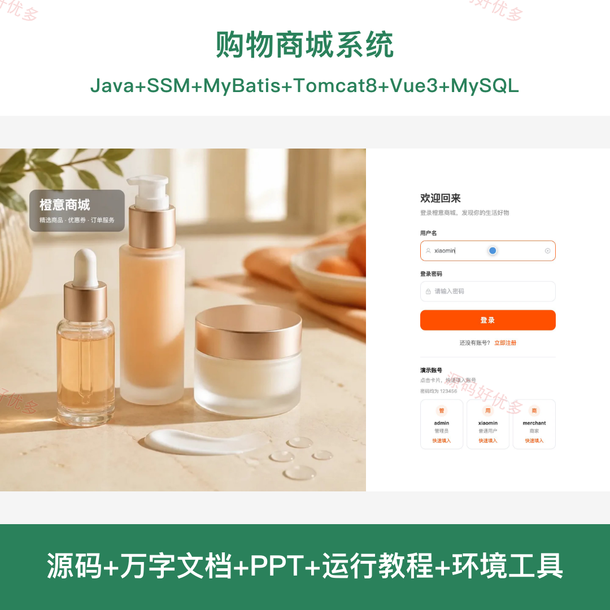
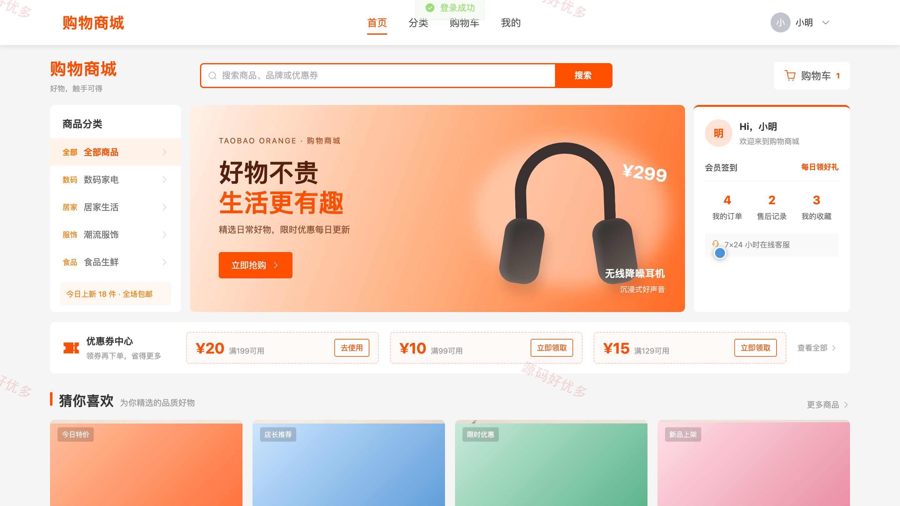
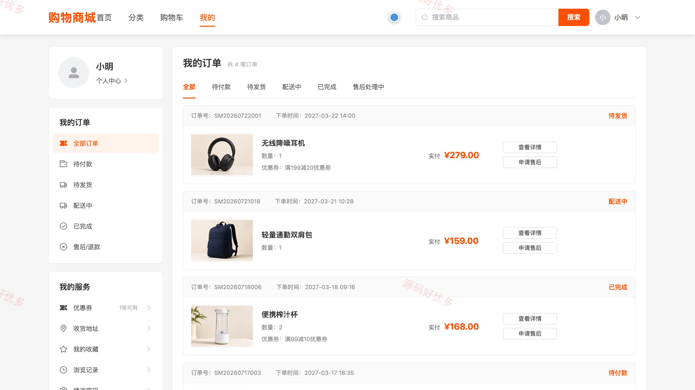
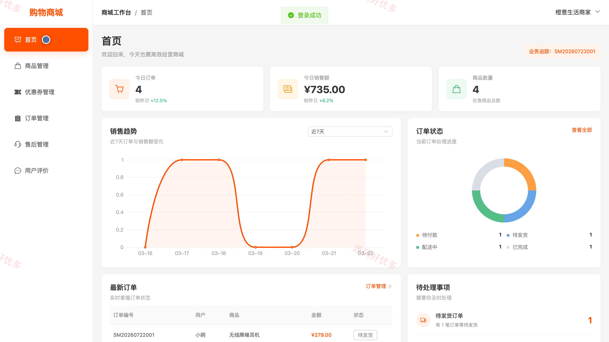
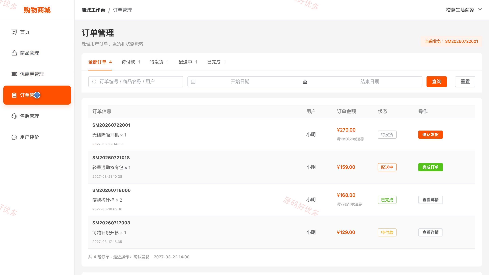
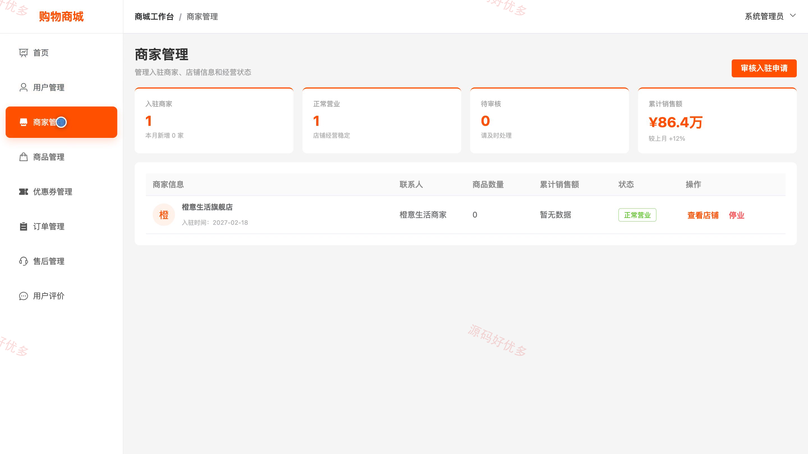
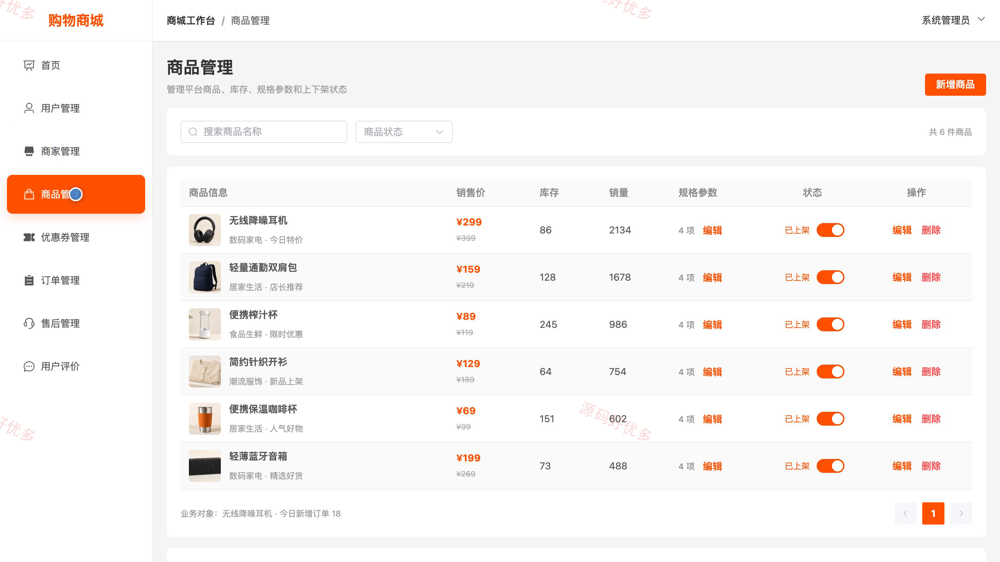

# bs002D
bs002D购物商城系统源码 Java SSM Vue3 设计文档 PPT
## 源码问题查看主页咨询

### 一、关键词
购物商城、在线购物、商品选购、网络零售、订单交易

### 二、作品包含
源码+数据库+万字设计文档+PPT+全套环境和工具资源+本地部署教程

### 三、项目技术
前端技术： Html、Css、Js、Vue3.4、Element-Plus
后端技术：Java、SSM（Spring 5.3.31、Spring MVC、MyBatis）

### 四、运行环境要求
开发工具：IDEA/eclipse + VSCODE

数据库：MySQL5.7+（共8张表）

数据库管理工具：Navicat10以上版本

环境配置软件： JDK1.8 + Maven3.6 + Tomcat8.5+

前端Nodejs：16+

浏览器：谷歌浏览器

### 五、项目介绍
项目编号：bs002D

购物商城系统面向用户、商家和管理员，提供商品浏览、购物车、下单与订单查询、商家商品及订单处理、平台用户与商家审核等页面。现有后端对用户、公告和轮播等数据使用数据库；部分商品与订单业务仍采用演示数据，相关操作尚未形成完整持久化交易闭环。

角色：用户、商家、管理员

用户功能：商品分类与搜索、商品详情浏览、购物车管理、收货地址维护、优惠券领取与使用、订单提交与查询、商品收藏与浏览记录、个人资料与密码维护。

商家功能：商品管理与上下架、库存维护、优惠券管理、订单处理与发货、售后申请处理、用户评价查看、经营数据查看、店铺资料维护。

管理员功能：用户信息管理、商家入驻审核、商品监管、优惠券管理、订单监管、售后与评价监管、平台数据统计、个人资料维护。

### 六、运行截图

